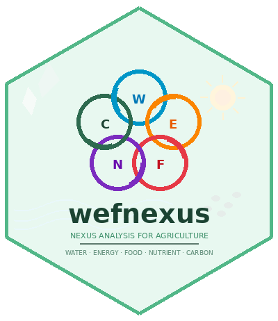
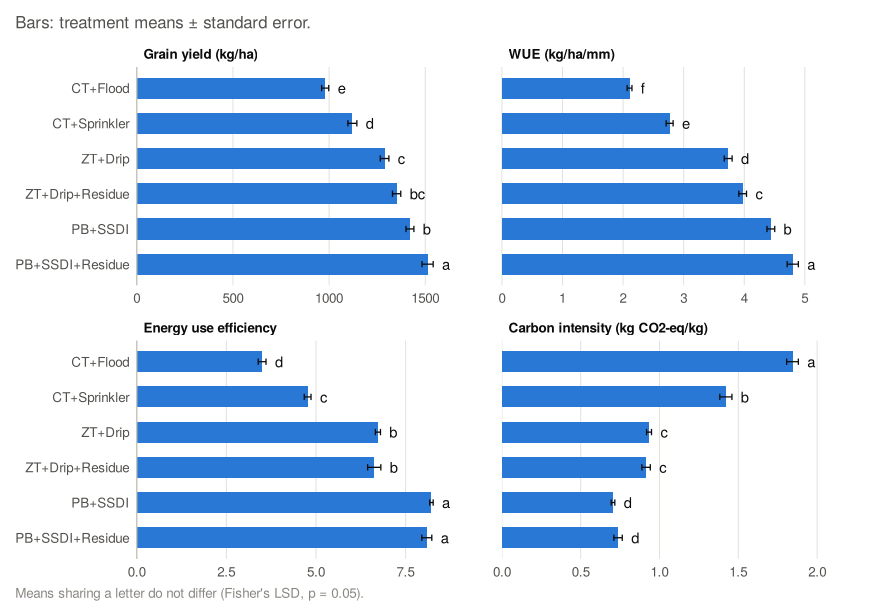
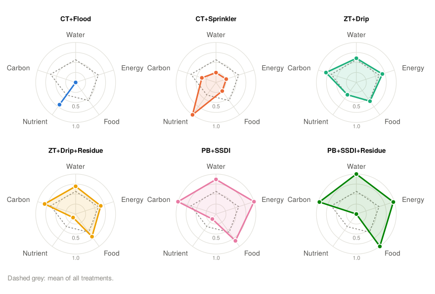
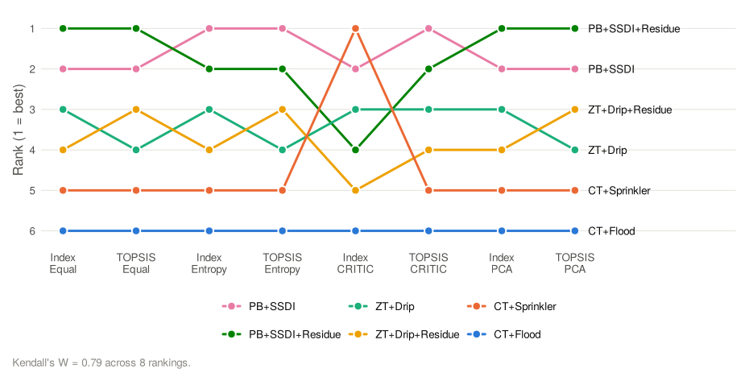

# wefnexus 

<!-- badges: start -->
[](https://github.com/lalitrolaniya/wefnexus/actions/workflows/R-CMD-check.yaml)
[](https://CRAN.R-project.org/package=wefnexus)
[](https://doi.org/10.32614/CRAN.package.wefnexus)
[](https://cran.r-project.org/web/licenses/GPL-3)
[](https://CRAN.R-project.org/package=wefnexus)
[](https://CRAN.R-project.org/package=wefnexus)
[](https://lifecycle.r-lib.org/articles/stages.html#stable)
[](https://www.codefactor.io/repository/github/lalitrolaniya/wefnexus)
[](https://lalitrolaniya.github.io/wefnexus/)
<!-- badges: end -->

> **One package. Five dimensions. Ten interlinkages.**
> A comprehensive R package for Water-Energy-Food-Nutrient-Carbon (WEFNC) nexus analysis in agricultural production systems.

---

## Why wefnexus?

Modern agriculture doesn't work in silos. When we save water, it affects energy use. When we add fertilizers, it impacts carbon emissions. When we change tillage, it affects food production, soil health, and everything in between.

**wefnexus** connects all 5 dimensions in one package — giving researchers, policymakers, and agronomists the tools to see the full picture and make decisions that are truly sustainable.

## Installation

Install the stable version from CRAN:

```r
install.packages("wefnexus")
```

Or install the development version from GitHub:

```r
# install.packages("devtools")
devtools::install_github("lalitrolaniya/wefnexus")
```

## What's new in 1.1.0

- **One call for a whole trial.** `nexus_analysis()` takes plot-level data
  (treatment x replication) and returns indicators, an ANOVA table, the
  composite nexus index and a TOPSIS ranking.
- **Journal-ready ANOVA.** `nexus_anova()` gives means with letter groups,
  SEm, CD (5%) and CV for CRD and RCBD trials.
- **Objective weights.** `nexus_weights()` derives weights by entropy,
  CRITIC or PCA instead of assuming equal weights.
- **TOPSIS ranking.** `nexus_topsis()` ranks treatments on raw indicators.
- **Energy budget from field records.** `energy_budget()` turns litres,
  kilograms and labour hours into MJ/ha, with direct/indirect and
  renewable/non-renewable shares, using an editable `energy_coefficients`
  table.
- **Robust rankings.** `nexus_rank_compare()` ranks treatments eight ways
  and reports Kendall's W, so you can show a recommendation does not
  hinge on one choice of weights.
- **Publication-ready figures.** `plot()` works on every result: means
  with error bars and letters, radar small multiples, TOPSIS rankings,
  energy budgets, and a trade-off heatmap with significance stars, all in
  a colour-blind-checked palette.
- **Legume-friendly.** `nexus_summary(nutrient_metric = "iue")` works when
  no fertilizer N is applied; `ef_n2o = 0.005` applies the IPCC dry-climate
  N2O factor.
- **Important fixes.** `soil_carbon_stock()` was 10 times too low, and
  `nexus_heatmap_gg()` swapped row labels; also fixed NHI in
  `nutrient_use_efficiency()`, `water_footprint(area)` and
  `nexus_summary()`. See [NEWS](NEWS.md).

## Modules

| Module | Functions | Key metrics |
|--------|-----------|-------------|
| 💧 **Water** | 7 | WUE, WP (physical/economic), WF (green/blue/grey), irrigation efficiency, CWSI, CWP, depleted fraction |
| ⚡ **Energy** | 11 | Energy budget from quantities, EUE, EROI, EP, energy intensity, specific energy, net energy, energy profitability |
| 🌾 **Food** | 8 | FPI, crop yield index, HI, LER, SPI, caloric and protein yield, PEI |
| 🧪 **Nutrient** | 8 | AE, PE, RE, PFP, IUE, NHI, NPK balance, one-call NUE report |
| 🌿 **Carbon** | 7 | CF (source-wise), GHG (IPCC Tier 1), SOC stock, sequestration rate, GWP (AR6), CSI |
| 🔗 **Nexus** | 16 | Normalization, composite index, entropy/CRITIC/PCA weights, TOPSIS, ranking robustness (Kendall's W), trade-off matrix and heatmap, sensitivity, radar, heatmap |
| 🧭 **Workflow** | 2 | `nexus_analysis()`, `nexus_anova()` |

## Quick start

### Replicated field trial in one call

```r
library(wefnexus)
options(wefnexus.verbose = FALSE)   # silence messages
data(arid_pulse_trial)              # 6 treatments x 3 replications (RCBD)

res <- nexus_analysis(
  arid_pulse_trial,
  treatment = "treatment", block = "replication",
  yield = "grain_yield", water = "total_water",
  energy_in = "energy_input", energy_out = "energy_output",
  emission = "ghg_emission", n_uptake = "n_uptake",
  weights = "entropy"
)
res          # nexus index and TOPSIS ranks
res$anova    # means + letters, SEm, CD (5%), CV
plot(res$nexus)
```

### Figures

```r
plot(res$anova, response = c("grain_yield", "WUE", "EUE", "CI"), ncol = 2)
```



```r
plot(res)   # one radar per treatment, dashed line = mean of all treatments
```



```r
nx <- res$nexus
indicators <- data.frame(WUE = nx$WUE_kg_mm, EUE = nx$EUE_ratio,
                         Yield = nx$yield_kg_ha, IUE = nx$IUE_kg_kgN,
                         CI = nx$carbon_intensity)
rc <- nexus_rank_compare(indicators, benefit = c(TRUE, TRUE, TRUE, TRUE, FALSE),
                         treatment_names = nx$treatment)
plot(rc)    # do rankings hold across eight weighting/aggregation methods?
```



### Energy budget from field records

```r
inputs <- data.frame(
  treatment = c("CT", "ZT"),
  human_labour_man = c(320, 240), diesel = c(65, 38),
  electricity = c(180, 75), nitrogen = c(20, 20), phosphorus = c(40, 40),
  seed = c(20, 20), herbicide = c(0, 0.75),
  grain = c(980, 1280), straw = c(1450, 1850)
)
energy_budget(inputs)
```

### Individual indicators

```r
data(arid_pulse_nexus)
d <- arid_pulse_nexus

water_use_efficiency(d$grain_yield, d$total_water)
eroi(d$energy_output_grain + d$energy_output_straw, d$energy_input)
carbon_footprint(diesel_use = 65, electricity_use = 180,
                 n_fertilizer = 20, yield = 980, ef_n2o = 0.005)
```

## Key features

- **59 functions** across 7 modules
- **One-call workflow** for replicated trials (CRD and RCBD)
- **Objective weighting** (entropy, CRITIC, PCA) and **TOPSIS** ranking
- **IPCC AR6 GWP** defaults (CH4 = 27, N2O = 273) with adjustable emission factors
- **Energy budgeting** from physical quantities with an editable coefficient table
- **S3 classes** with `print()`, `summary()` and `plot()` methods
- **Publication-ready figures** (ggplot2) for every result, plus base-R radar and heatmap
- **Vectorized**: every indicator works on whole columns
- **Arid and semi-arid, pulse-based and conservation agriculture** focus
- **590+ test checks**, verified against hand calculations and reference implementations
- Free and open source under GPL-3

## Documentation

```r
# Complete vignette with all 6 modules
browseVignettes("wefnexus")

# View the built-in sample dataset
?arid_pulse_nexus

# Help for any function
?carbon_footprint
?nexus_summary
?water_use_efficiency
```

📖 **Full documentation website:** [https://lalitrolaniya.github.io/wefnexus/](https://lalitrolaniya.github.io/wefnexus/)

## Data format

Use **replication-level data** (one row per plot) where you can. It keeps
the variability needed for ANOVA, SEm and CD, and `nexus_analysis()`
handles the aggregation to treatment means. Treatment means also work;
ANOVA is then skipped.

## Citation

If you use wefnexus in your research, please cite:

```r
citation("wefnexus")
```

```
Rolaniya, L.K., Poonia, H., Jat, R.L., Punia, M. & Choudhary, R.R. (2026).
wefnexus: Water-Energy-Food-Nutrient-Carbon Nexus Analysis for Agronomic
Systems. R package version 1.1.0. https://CRAN.R-project.org/package=wefnexus
DOI: 10.32614/CRAN.package.wefnexus
```

## Authors

| Author | Affiliation |
|--------|-------------|
| **Lalit Kumar Rolaniya** (maintainer) | Scientist (Agronomy), ICAR-IIPR RC Bikaner |
| **Hemant Poonia** (deceased) | Assistant Professor, Dept of Mathematics & Statistics, CCS HAU Hisar |
| **Ram Lal Jat** | Scientist, ICAR-IIPR RC Bikaner |
| **Monika Punia** (deceased) | Scientist, ICAR-IIPR RC Bikaner |
| **Raja Ram Choudhary** | Scientist, ICAR-IIGR RRS Bikaner |

*Version 1.1.0 is dedicated to the memory of our co-authors Dr. Monika Punia and Dr. Hemant Poonia.*

## Links

| Resource | URL |
|----------|-----|
| 📦 CRAN | [https://CRAN.R-project.org/package=wefnexus](https://CRAN.R-project.org/package=wefnexus) |
| 📖 Documentation | [https://lalitrolaniya.github.io/wefnexus/](https://lalitrolaniya.github.io/wefnexus/) |
| 💻 Source Code | [https://github.com/lalitrolaniya/wefnexus](https://github.com/lalitrolaniya/wefnexus) |
| 🔗 DOI | [10.32614/CRAN.package.wefnexus](https://doi.org/10.32614/CRAN.package.wefnexus) |

## Contributing

We welcome contributions! Please see [CONTRIBUTING.md](https://github.com/lalitrolaniya/wefnexus/blob/main/CONTRIBUTING.md) for guidelines.

Found a bug? Have a feature request? [Open an issue](https://github.com/lalitrolaniya/wefnexus/issues)

## Support

If you find this package useful, please ⭐ **star this repository** — it helps others discover it!

## License

GPL (>= 3)
